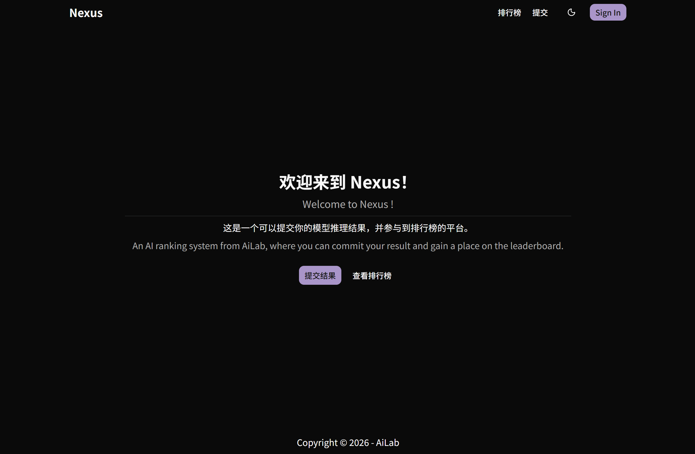

# Nexus - AI 比赛打榜系统

> 🚀 Nexus, 一个用于人工智能比赛打榜的系统，旨在提供简洁、易用、可扩展的比赛打榜平台，基于 SpringBoot + Next.js。

## 📋 概览 Overview

* **当前版本**：v1.0.0
* **Web-UI 默认端口**：7842
* **建议使用 Docker 部署**



---

## ✨ 功能概述 Features
### 1. 用户账号
* 提供用户账号 注册 + 登录 功能
* 未登录用户可以查看排行榜，但提交结果需要登录

### 2. 文件上传 + 个人提交记录
* 在账号登录之后，提供 .csv 文件上传功能
* 在文件上传框下方，将显示个人提交记录


### 3. 自动评测
* 核心算法：根据选手提交的 .csv ，和 `ground_truth` 比对计算准确率
* 高自定义：可自定义 判分脚本 和 `ground_truth`
* 可横向扩展：支持同时运行多个评测节点，自动负载均衡
* Rabbit MQ 消息队列，异步消费评测任务

### 4. 自动计算排行榜
* 自动取用户最高分数计入排行榜
* 排行榜保存在数据库中，按分数由高到低排序


---

## 📥 快速开始 Quick Start

### 🐳 使用 Docker 部署
> 强烈建议使用 Docker 部署该项目，可大大降低部署复杂度。

`docker-compose.yml` 示例：

```yml

```

### 📦 Build from soure
1. 下载源代码

    ```bash
    git clone https://github.com/X-xiaohan521/AiRankingSystem.git
    ```

2. 部署 frontend

    部署前端需要安装 npm，确保安装后，进入 `./frontend` 目录，执行：

    ```bash
    npm run build
    npm run start
    ```

    即可在 `localhost:7842` 看到前端页面。

3. 部署 backend

    部署后端需要 JRE 21 环境 以及 maven，进入 `./backend` 目录，执行：
    ```bash
    mvn clean package
    java -jar ./target/backend-1.0.0.jar
    ```
    即可在 `localhost:6780` 启动后端服务。

4. 部署评测节点 evaluator

    部署评测节点前需要先部署 Rabbit MQ，具体方法详见 [Installing RabbitMQ](https://www.rabbitmq.com/docs/download) 官方文档。

    此外，还需准备 uv 用于管理 python 包。准备完成后，进入 `./evaluator` 目录，执行：
    ```bash
    uv sync
    uv run ./src/main/main.py
    ```
    即可启动一个评估节点。值得注意的是，评估节点可以同时启动多个，支持节点自动负载均衡。


---

## ⚙️ 配置文件

Nexus 使用 `config.json` 持久化服务端配置。字段解释如下：

```json
{
  "leaderboardRefreshRate": 3600,   // 排行榜刷新间隔，单位：s（秒）
  "correctAnswer": "/data/correct_answer.txt",   // 标准答案路径
  "isLeaderboardEnabled": true   // 排行榜是否开启
}
```
