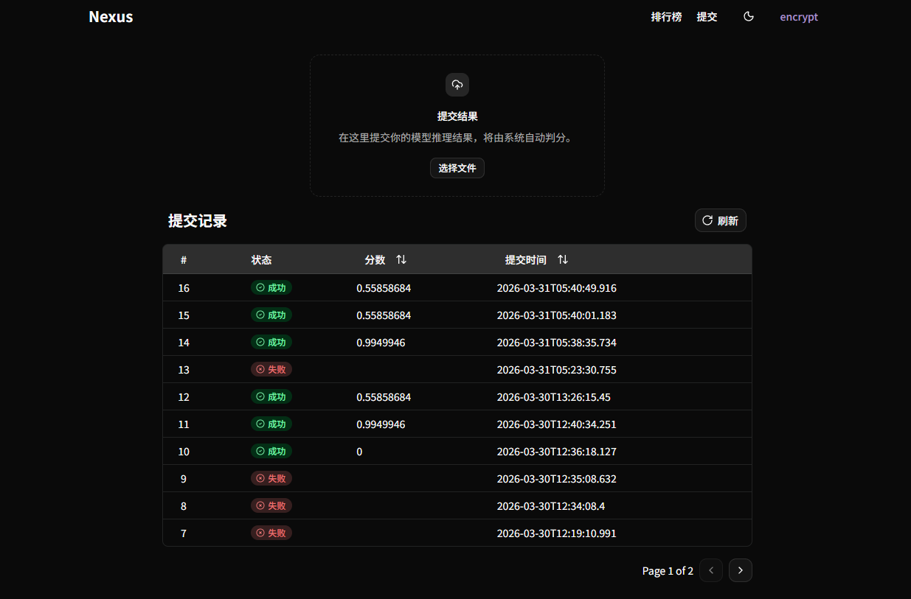
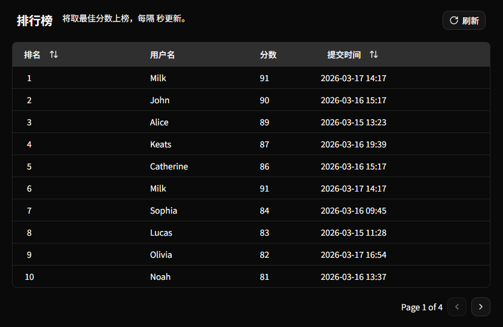

# AI 打榜比赛系统

> 一个用于人工智能比赛打榜的系统，基于 SpringBoot + Next.js。

当前版本：v1.0.0

## 功能描述
### 1. 账号
* 提供账号 注册 + 登录，实名由额外表单完成
* 进入系统先检查是否登录，没有登录则跳转到登录页，并在登录卡片上提供注册按钮 -> 跳转到注册页

### 2. 文件上传 + 个人提交记录
* 在账号登录之后，提供文件 .csv / .xml / .txt 上传功能
* 在文件上传框上方显示：“当前时段将提交至 A 榜”
* 在文件上传框下面，显示个人提交记录

```text
-----------
|         |
|  点击   |
|  提交   |
-----------

确认提交    取消
```

| # | 状态（成功/失败/判分中） | 分数 | 提交时间 |
| - | ---------------- | ---- | ------- |
| 1 |     √ 成功       | 83 | 2026-03-15 22:30 |
| 2 |     X 失败       | 无 | 2026-03-16 09:24 |
| 3 |     O 判分中      | 无 | 2026-03-17 14:17 |



### 3. 判分
* 核心算法：根据选手提交的 .csv / .xml / .txt，和标准答案比对计算准确率

### 4. 榜单
* 计算的分数保存在数据库中，按分数由高到低排序

| 排名 | 用户名 | 分数 | 提交时间 |
| --- | ------ | ---- | ------- |
| 1   | Milk   | 91   | 2026-03-17 14:17 |
| 2   | John   | 90   | 2026-03-16 15:17 |
| 3   | Alice   | 88   | 2026-03-15 17:43 |



* A 榜单：某时段（YYYY-mm-dd hh-mm-ss ~ YYYY-mm-dd hh-mm-ss）开放，到截止时间后静止（不允许再提交）
* B 榜单：从 A 榜单静止后开放，只有 A 榜单排名到前 n% 才允许提交到 B 榜单

## 管理面板

* 设置排行榜刷新间隔
* 设置提交启闭时间 / 立即启闭提交
* 设置正确答案
* 查看所有提交记录

## 数据库设计
### 数据表及字段
#### 1. user 表
| id | username | password | role 0(user) / 1(admin) |
| --- | ------ | ---------- | --- |
| 1   | Milk   | $2a$10$...   | 1 |
| 2   | John   | $2a$10$...   | 0 |

#### 2. submission 表
| id | file_uri | status 0(failed) / 1(success) / 2(pending) | score | submission_time | user_id |
| --- | ------ | ------ | ---------- | ----------| --------- |
| 1   |  /submission/4a275939-f701-4afb-b1e0-4dcab814a4ea.txt   | 1 | 91 | 2026-03-17 14:17 | 1 |
| 2   |  /submission/5a2b833c-3113-40ce-aa22-3a8ac6ccf7bd.txt   | 0 | null | 2026-03-16 09:24 | 3 |
| 3   |  /submission/ef718657-eb25-4b5b-8263-0217e83490a0.txt   | 1 | 90 | 2026-03-16 15:17 | 2 |


#### 3. leaderboard 表
| id | user_id | username | submission_id | highest_score | submission_time |
| -- | ------- | -------- | ------------- | ------------- | --------------- |
| 1  |    1    | Milk     |  1            |  91           | 2026-03-17 14:17 |
| 2  |    2    | John     |  3            |  90           | 2026-03-16 15:17 |

> 注：leaderboard 表不包含任何额外信息，故可以删除，随时从 user 和 submission 表重建。leaderboard 表的刷新为定时任务，按照一定时间间隔自动根据上两张表生成。

---

## 配置文件

使用 `config.json` 配置文件存储服务端配置。

```json
{
  "leaderboardRefreshRate": 3600,   // 单位：s（秒）
  "correctAnswer": "/data/correct_answer.txt",   // 标准答案路径
  "isLeaderboardEnabled": true   // 排行榜是否开启
}
```

---

## API 接口设计

AiRankingSystem 在 `/api` 路径下提供 REST API。除登录/注册外，所有端点都需要 JWT 认证。

**基础 URL：** `http://your-host:6780/api`

**认证：** 将 JWT 令牌作为 `Authorization: Bearer <token>` 请求头传入。

---

### 响应
> 所有 api 响应均为统一格式
```json
{
  "code": 1,
  "message": "",
  "data": {}
}
```
* "code": 1（成功） 或 0（失败）
* "message": 成功信息 或 失败原因
* "data": 如果响应有数据，均放置在该字段

---

### 认证

#### 1. 登录

```
POST /auth/login
```

使用用户名和密码进行认证。

**请求体：**
```json
{
  "username": "string",
  "password": "string"
}
```

**响应：**
* 成功
    ```json
    {
      "code": 1,
      "data": {
            "token": "<token>"
        },
      "msg": "登录成功~"
    }
    ```
* 失败
    ```json
    {
      "code": 0,
      "data": null,
      "msg": "用户名或密码无效。"
    }
    ```

---

#### 2. 注册

```
POST /auth/register
```

使用用户名和密码进行注册。

**请求体：**
```json
{
  "username": "string",
  "password": "string"
}
```

**响应：**
* 成功
    ```json
    {
      "code": 1,
      "data": {
            "token": "<token>"
        },
      "msg": "注册成功~"
    }
    ```
* 失败
    ```json
    {
      "code": 0,
      "data": null,
      "msg": "用户名已存在。"
    }
    ```

---

#### 3. 刷新令牌

```
GET /auth/refreshToken
```

刷新当前的认证令牌。

**响应：**
* 成功
    ```json
    {
      "code": 1,
      "data": {
            "token": "<newToken>"
        },
      "msg": "令牌已刷新。"
    }
    ```
* 失败
    ```json
    {
      "code": 0,
      "data": null,
      "msg": "令牌无效，请重新登录。"
    }
    ```

---

#### 4. 登出

```
GET /auth/logout
```

清除认证令牌并登出。

**响应：**
* 成功
    ```json
    {
      "code": 1,
      "data": null,
      "msg": "登出成功。"
    }
    ```
* 失败
    ```json
    {
      "code": 0,
      "data": null,
      "msg": "用户未登录。"
    }
    ```

---

### 用户
#### 1. 获取当前用户信息

```
GET /user/me
```

根据所携带 token 返回用户信息。

**响应：**
* 成功
    ```json
    {
      "code": 1,
      "data": {
        "username": "<username>",
        "role": 0
      },
      "msg": ""
    }
    ```
* 失败
    ```json
    {
      "code": 0,
      "data": null,
      "msg": "令牌无效，请重新登录。"
    }
    ```

---

### 提交
#### 1. 获取当前用户所有提交记录

```
GET /submission
```

根据所携带 token 返回用户所有提交记录（按照提交时间倒序排列）。

* 成功
    ```json
    {
      "code": 1,
      "data": [
        {"id": 3, "status": 2, "score": null, "submissionTime": "2026-03-17 14:17"},
        {"id": 2, "status": 0, "score": null, "submissionTime": "2026-03-16 09:24"},
        {"id": 1, "status": 1, "score": 83, "submissionTime": "2026-03-15 22:30"}
      ],
      "msg": ""
    }
    ```
* 失败
    ```json
    {
      "code": 0,
      "data": null,
      "msg": "令牌无效，请重新登录。"
    }
    ```

#### 2. 上传一次提交

```
POST /submission
```

请求体格式：multipart/form-data

仅允许上传规定的 submission 文件格式。

**响应：**
* 成功
    ```json
    {
      "code": 1,
      "data": null,
      "msg": ""
    }
    ```
* 失败
    ```json
    {
      "code": 0,
      "data": null,
      "msg": "文件不符合要求，请重新提交。"
    }
    ```

---

### 排行榜
#### 1. 获取当前排行榜

```
GET /leaderboard
```

获取排行榜数据，按照分数由高到低排列。

* 成功
    ```json
    {
      "code": 1,
      "data": {
        "leaderboardRefreshRate": 3600,
        "leaderboardData": [
          {"rank": 1, "username": "Milk", "score": 91, "submissionTime": "2026-03-17 14:17"},
          {"rank": 2, "username": "John", "score": 90, "submissionTime": "2026-03-16 15:17"}
        ],
      },
      "msg": ""
    }
    ```
* 失败
    ```json
    {
      "code": 0,
      "data": null,
      "msg": "你没有权限这么做。"
    }
    ```

---

### 管理接口
> 以下接口均只允许管理员访问，需携带管理员用户的 token 访问。

#### 1. 获取所有提交记录

```
GET /admin/submission
```

允许携带参数：`/admin/submission?page=1&pageSize=10`

所有提交记录分页查询，按照提交时间倒序排列。

* 成功
    ```json
    {
      "code": 1,
      "data": [
        {"id": 3, "username": "John", "status": 1, "score": 81, "submissionTime": "2026-03-17 14:17"},
        {"id": 2, "username": "Alice", "status": 0, "score": null, "submissionTime": "2026-03-16 09:24"},
        {"id": 1, "username": "Milk", "status": 2, "score": 83, "submissionTime": "2026-03-15 22:30"}
      ],
      "msg": ""
    }
    ```
* 失败
    ```json
    {
      "code": 0,
      "data": null,
      "msg": "你没有权限这么做。"
    }
    ```
    
---

#### 2. 获取当前配置

```
GET /admin/config
```

获取当前系统配置信息。

* 成功
    ```json
    {
      "code": 1,
      "data": {
        "leaderboardRefreshRate": 3600,   // 单位：s（秒）
        "correctAnswer": "/data/correct_answer.txt",   // 标准答案路径
        "isLeaderboardEnabled": true   // 排行榜是否开启
      },
      "msg": ""
    }
    ```
* 失败
    ```json
    {
      "code": 0,
      "data": null,
      "msg": "你没有权限这么做。"
    }
    ```

---

#### 3. 修改当前配置

```
PUT /admin/config
```

请求体格式：application/json

请求体：

```json
{
  "leaderboardRefreshRate": 3600,   // 单位：s（秒）
  "correctAnswer": "/data/correct_answer.txt",   // 标准答案路径
  "isLeaderboardEnabled": true   // 排行榜是否开启
}
```

> 可以仅传递需要修改的字段，留空的配置将不会修改。

---

#### 4. 上传正确答案

```
POST /admin/answer
```

请求体格式：multipart/form-data

仅允许上传规定的 submission 文件格式，先前的答案不会被覆盖。

**响应：**
* 成功
    ```json
    {
      "code": 1,
      "data": null,
      "msg": ""
    }
    ```
* 失败
    ```json
    {
      "code": 0,
      "data": null,
      "msg": "文件不符合要求，请重新提交。"
    }
    ```