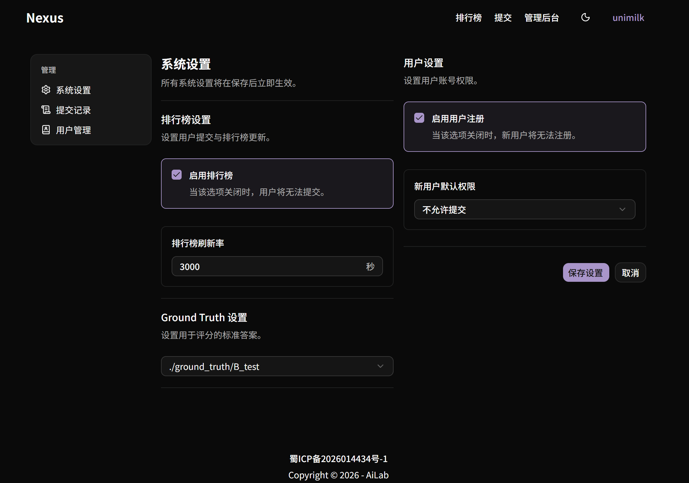
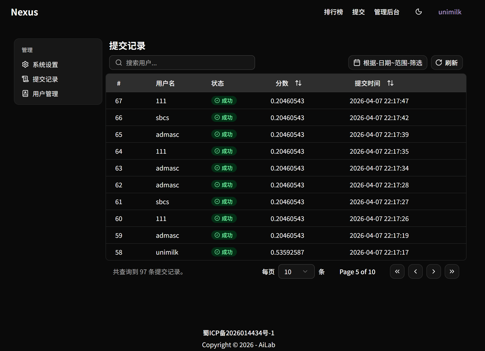
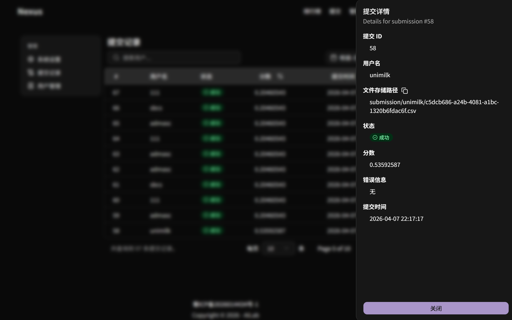
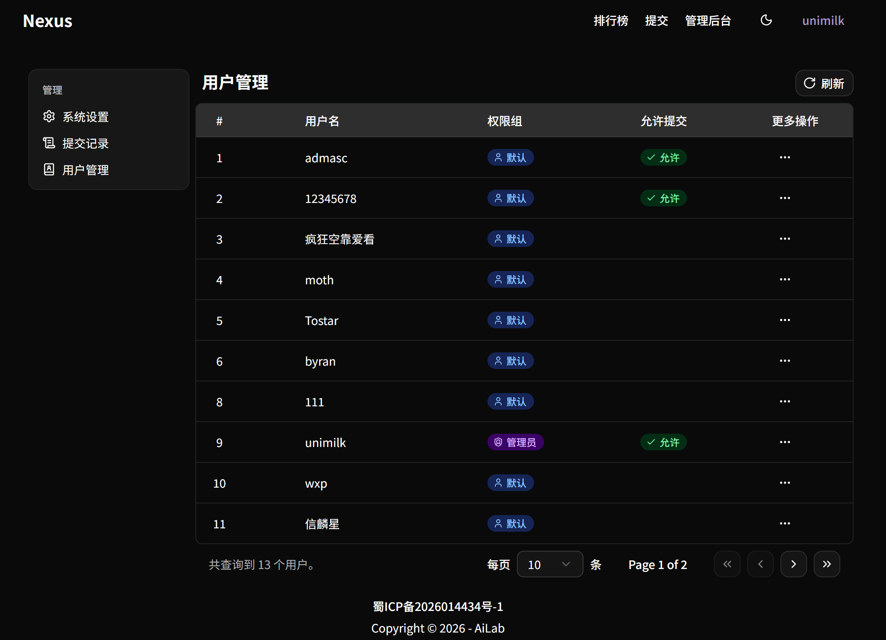

# Nexus - AI 比赛打榜系统

> 🚀 Nexus, 一个用于人工智能比赛打榜的系统，旨在提供简洁、易用、可扩展的比赛打榜平台，基于 SpringBoot + Next.js。

## 📋 概览 Overview

* **当前版本**：v1.1.2
* **Web-UI 默认端口**：7842
* **建议使用 Docker 部署**


---

## ✨ 功能概述 Features
### 1. 用户账号
* 提供用户账号 注册 + 登录 功能
* 未登录用户可以查看排行榜，但提交结果需要登录
* 具有管理员权限的用户可以访问管理后台，进行服务端配置等操作

### 2. 文件上传 + 个人提交记录
* 在账号登录之后，提供 .csv 文件上传功能
* 在文件上传框下方，将显示个人提交记录


### 3. 自动评测
* 核心算法：根据选手提交的 .csv ，和 `ground_truth` 比对计算准确率
* 高自定义：可自定义 判分脚本 和 `ground_truth`
* 可横向扩展：支持同时运行多个评测节点，自动负载均衡
* Rabbit MQ 消息队列，异步消费评测任务

### 4. 自动计算排行榜
* 自动取用户最高分数计入排行榜
* 排行榜保存在数据库中，按分数由高到低排序


### 5. 管理面板
- 系统设置

  

- 提交记录
  > 在这里可以查看所有用户的全部提交记录。

  

  > 点击记录可以查看详细信息。

  

- 用户管理

  
---

## 📥 快速开始 Quick Start

### 🐳 使用 Docker 部署
> 强烈建议使用 Docker 部署该项目，可大大降低部署复杂度。

`docker-compose.yml` 示例：

```yml
services:
  backend:
    image: unimilk/nexus:backend-1.1.2
    ports:
      - "6780:6780"
    volumes:
      - /data/nexus:/app/data
    environment:
      TZ: Asia/Shanghai
      JWT_SECRET: <生成你自己的 JWT_SECRET>
      NEXUS_DATA: /app/data
      NEXUS_CAPTCHA_ID: <你的极验 CAPTCHA_ID>
      NEXUS_CAPTCHA_KEY: <你的极验 CAPTCHA_KEY>
      NEXUS_MQ_HOST: rabbit
    depends_on:
      - rabbit-mq
  frontend:
    image: unimilk/nexus:frontend-1.1.1
    ports:
      - "7842:7842"
    environment:
      TZ: Asia/Shanghai
      NEXUS_BACKEND_HOST: backend
    depends_on:
      - backend
  evaluator:
    image: unimilk/nexus:evaluator-1.1.1
    volumes:
      - /data/nexus:/app/data
    environment:
      TZ: Asia/Shanghai
      NEXUS_DATA: /app/data
      NEXUS_MQ_HOST: rabbit
    depends_on:
      - rabbit-mq
      - backend
  rabbit-mq:
    image: rabbitmq:4-management
    hostname: rabbit
    environment:
      TZ: Asia/Shanghai
    ports:
      - "15672:15672"
      - "5672:5672"
```

### 📦 Build from soure
1. 下载源代码

    ```bash
    git clone https://github.com/X-xiaohan521/AiRankingSystem.git
    ```

2. 部署 frontend

    部署前端需要安装 npm，确保安装后，进入 `./frontend` 目录，执行：

    ```bash
    npm run build
    npm run start
    ```

    即可在 `localhost:7842` 看到前端页面。

3. 部署 backend

    部署后端需要 JRE 21 环境 以及 maven，进入 `./backend` 目录，执行：
    ```bash
    mvn clean package
    java -jar ./target/backend-1.1.2.jar
    ```
    即可在 `localhost:6780` 启动后端服务。

4. 部署评测节点 evaluator

    部署评测节点前需要先部署 Rabbit MQ，具体方法详见 [Installing RabbitMQ](https://www.rabbitmq.com/docs/download) 官方文档。

    此外，还需准备 uv 用于管理 python 包。准备完成后，进入 `./evaluator` 目录，执行：
    ```bash
    uv sync
    uv run ./src/main/main.py
    ```
    即可启动一个评估节点。值得注意的是，评估节点可以同时启动多个，支持节点自动负载均衡。


---

## 🧾 数据目录
> 首次启动后端时，会在环境变量 `NEXUS_DATA` 值所在目录下生成 `./data` 目录，结构如下：
```dtp
data/
├── ground_truth
├── log
│   ├── backend
│   │   ├── 2026-03-29-0.log
│   │   ├── 2026-03-30-0.log
│   │   └── 2026-03-31-0.log
│   └── evaluator
│       └── evaluator.log
├── submission
│   ├── Alice
│   │   ├── 189385ba-ab19-408f-b519-932c48eafcfc.csv
│   │   └── 3445d9de-2ee3-41bc-9d3d-2f42bff16af7.csv
│   ├── jusus
│   │   └── cb20f6c3-23f8-4d5d-acc4-e15dee1fa7ef.csv
│   ├── Milk
│   │   └── 91f215cd-79f1-4125-a8de-beff8c474efe.csv
│   └── test
│       ├── 1022ba5c-3816-45b8-a8dd-0c6dc3bafe4a.csv
│       ├── 382daaac-a614-419b-81dc-742c03a18ad4.csv
│       ├── 425394cf-b1f5-42c7-9f93-fe503c920f09.csv
│       ├── 89eb80ba-a19e-4b40-a9db-2f7a64998058.csv
│       ├── b5f8f378-1807-4eea-882f-1a94829031f3.csv
│       └── ef500966-c653-4f5d-846a-c0423ae02914.csv
├── config.json
└── data.db
```

---

## ⚙️ 配置文件

Nexus 使用 `config.json` 持久化服务端配置。字段解释如下：

```json
{
    "leaderboardRefreshRate": 3600,   // 排行榜刷新间隔，单位：s（秒）
    "groundTruth": "./ground_truth/A_test",   // ground_truth 路径
    "isLeaderboardEnabled": true,   // 排行榜是否开启
    "allowRegistration": true,   // 是否允许新用户注册
    "defaultAllowSubmit": 1   // 是否默认允许新用户提交
}
```

> [!NOTE]
> 手动修改配置文件后，需要 **重启后端服务** 或 **调用获取配置接口** 才能生效。

---

## 🛠️ 技术栈
> 本项目为全栈平台极项目，使用技术栈如下：
* Java Spring Boot
* Spring Data JPA
* Spring Security
* Next.js
* Tailwind CSS
* Shadcn UI
* Rabbit MQ
* Docker
* Python

---

## 📜 Changelog

> 📌 此处只列出最新版本，更早版本详见 `CHANGELOG.md`。

### [1.1.2] - 2026-11-24

### 🛠 修复
- 修复了 CVE-2026-114938（代号 “Java4Shell” ）漏洞。

> 此次发布仅包含受影响的 backend 后端。

---

## 📞 联系方式
> 如果你需要帮助，或有部署、商业合作等需求，欢迎联系我。
### 📧 Email: unimilk891@gmail.com
### 🌐 GitHub: [X-xiaohan521](https://github.com/X-xiaohan521/)

---

## 📌 结语
### 感谢使用 Nexus！如果你觉得这个平台好用，请 Star ⭐ 这个 GitHub 项目，或在评论区留言反馈！🚀